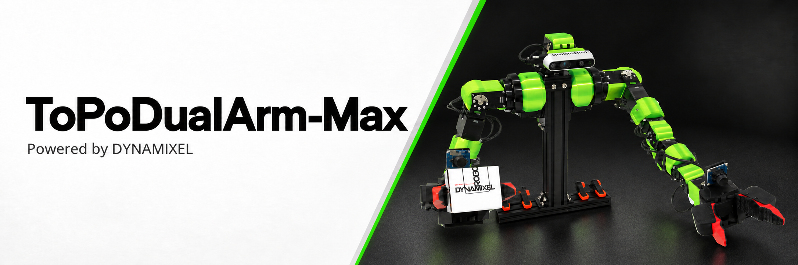

# ToPoDualArm

ToPoDualArm-Maxは、フィジカルAIの研究開発向けに、左右それぞれ7自由度のアームを備えた双腕ロボットです。各軸にはROBOTIS製DYNAMIXEL XM430／XM540とベアリングを採用し、把持操作やロボット制御の実験に使えるYUBI互換のToPoGripperを標準搭載しています。

YUBI Gloveと組み合わせて導入する場合は、[ToPoDualArm-Max フィジカルAIキット](https://fuzzrobo-shop.i17.bcart.jp/product.php?id=137)をご覧ください。

## サンプル

- [ACT模倣学習デモ](demo/README.md)
- [ROS2](ros2/README.md)

[製品ページ](https://fuzzrobo-shop.i17.bcart.jp/product.php?id=129)
