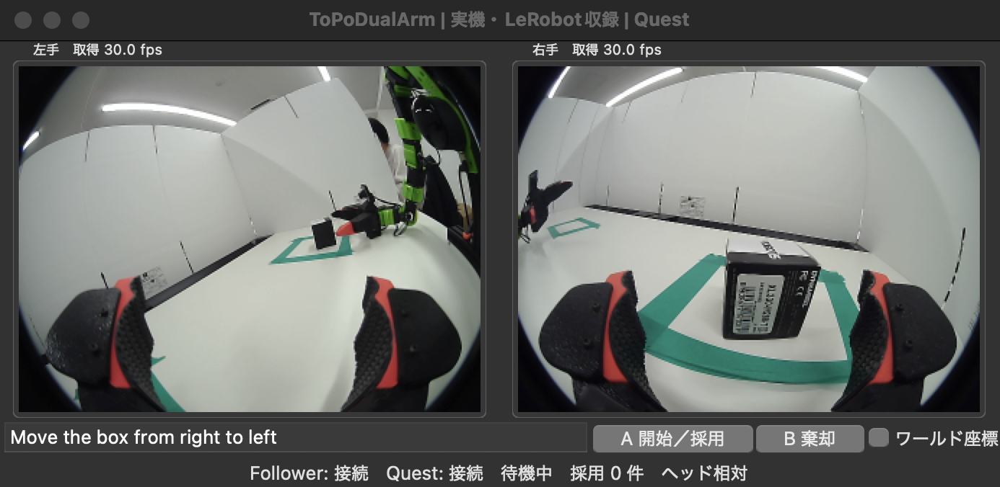

# ToPoDualArm ACTデモ


左右手首の320×240画像と関節の実測角・指令角をLeRobot形式で収録し、ACTを学習します。標準は16軸、パンチルト付きは18軸です。構成を変更するときは新しい収録先と学習先を指定します。

## 環境構築

[uv](https://docs.astral.sh/uv/getting-started/installation/) をインストールしてから、環境を構築します。

### Macの場合

```sh
brew install eigen@3 yaml-cpp tinyxml2
cd demo
uv sync --managed-python --python 3.12
```

U2D2とカメラを接続し、ポート名とカメラIDを確認します。

```sh
uv run python -m serial.tools.list_ports -v
uv run python - <<'PY'
from AVFoundation import AVCaptureDevice, AVMediaTypeVideo, AVMediaTypeMuxed

for media in (AVMediaTypeVideo, AVMediaTypeMuxed):
    for camera in AVCaptureDevice.devicesWithMediaType_(media):
        print(camera.localizedName(), camera.uniqueID())
PY
```

[demo.yaml](demo.yaml) の `robot.port` にフォロワーの `/dev/cu.usbserial-…`、`cameras.left` と `cameras.right` に対応するカメラIDを文字列で指定します。

### Linuxの場合

```sh
sudo apt update
sudo apt install build-essential cmake libeigen3-dev libyaml-cpp-dev libtinyxml2-dev
cd demo
uv sync --managed-python --python 3.12
```

U2D2とカメラを接続し、デバイスパスを確認します。

```sh
ls -l /dev/serial/by-id/
ls -l /dev/v4l/by-path/*-video-index0
```

[demo.yaml](demo.yaml) の `robot.port` にフォロワーの `/dev/serial/by-id/…`、`cameras.left` と `cameras.right` に各カメラの `/dev/v4l/by-path/…-video-index0` を指定します。

### パンチルトを使う場合

`demo.yaml` の `robot.hardware` が参照する機体YAML（既定は [follower.yaml](../config/hardware/follower.yaml)）で `modules: [pan_tilt]` を設定します。正面カメラも収録する場合は、`demo.yaml` に `cameras.front` を追加します。

## データ収集

データ収集には、**Quest、V-Sido、Glove、U2D2リーダー**の4つの方法があります。`demo/` で使う入力のコマンドを実行します。



`demo.yaml` の `task` と `record.root` にタスクと未使用の保存先を指定します。保存先は入力YAMLの `root` で上書きできます。GUIで左右の映像を確認し、A で開始・保存、B で棄却します。

サーボ設定は [follower.yaml](../config/hardware/follower.yaml) にあります。

### 1. Quest

`quest.quest_host` にYubiQuestAppを起動したQuestのIPを設定します。入力設定は [config/quest.yaml](config/quest.yaml)、座標校正は [config/teleop/quest.yaml](../config/teleop/quest.yaml) にあります。

```sh
uv run demo record config/quest.yaml
```

| ボタン | 操作 |
|---|---|
| **Grip** | 握っている間、対応する腕が追従します。放すと姿勢を保持します。 |
| **人差し指トリガー** | 押すと対応するグリッパーが閉じ、放すと設定した開度に戻ります。 |
| **A** | 待機中は収録開始、収録中は採用して保存します。 |
| **B** | 収録中の試行を棄却します。 |

### 2. V-Sido

バイラテラル操作中の関節状態をUDPで収録します。 [V-Sido接続方法・通信仕様](../v-sido.md)

```sh
uv run demo record config/vsido.yaml
```

### 3. Glove

左右の `encoder_port`、`encoder_id`、開閉端を設定します。腕と首を保持し、グリッパーを操作します。 [config/glove.yaml](config/glove.yaml)

```sh
uv run demo record config/glove.yaml
```

### 4. U2D2リーダー

`leader.port` にリーダー側のU2D2ポートを設定します。物理リーダーを動かしてフォロワーを操作します。 [config/u2d2.yaml](config/u2d2.yaml)

```sh
uv run demo record config/u2d2.yaml
```

## 学習

収録済みデータから学習する場合は、実機の接続設定は不要です。

既定では `record.root` のデータから左右手首の2視点で学習し、デモの `outputs/` 以下に学習結果を保存します。保存先は `train.output` で指定します。入力YAMLで収録先を上書きした場合は、学習時にそのパスを指定します。V-Sidoのデータセットは収録先の `vsido/` 以下に保存されます。CUDAが使える場合はGPU、それ以外はCPUを使います。

```sh
uv run demo train
# 収録先を上書きした場合
uv run demo train data/収録先
```

## 推論


`infer.models` に登録したACTモデルをGUIで選び、「推論開始」を押します。「停止」で姿勢を保持します。`infer.models` を省略すると `train.output` の学習済み重みを読み込みます。任意の単一モデルを使う場合は `infer.checkpoint` を指定します。

### U2D2接続の場合

`demo.yaml` の `infer.backend` を `u2d2` に設定します。

```sh
uv run demo infer
```

既存の18軸ACTプリセットを使う場合は、機体YAMLで `modules: [pan_tilt]` を設定し、`uv run demo infer --config config/infer-pan-tilt.yaml` で起動します。ポートとカメラは `demo.yaml` から読み込みます。

### V-Sido接続の場合

V-Sidoを通常モードにし、`demo.yaml` の `infer.backend` を `vsido` に設定します。 [V-Sido接続方法・通信仕様](../v-sido.md)

```sh
uv run demo infer
```

## SDK

Pythonバインディングはデモの `uv sync` でビルドされます。フォロワーは `role="follower"`、リーダーは `role="leader"` で開きます。以下は校正済みの機体を使う例です。

```python
from topoarm_sdk import Device

with Device("path/to/follower.yaml", role="follower", hardware_verified=True) as arm:
    arm.enable()
    q = arm.read().position  # 関節名ごとの角度（rad）
    applied = arm.command(q)
```

既定の通信設定は2 Mbps、Return Delay Timeはレジスタ値 `10`（20 µs）です。`startup_configuration: apply` では、全IDと型番を確認し、トルクOFFでEEPROMの差分を適用します。駆動開始時にはフォロワーの現在位置を目標にします。

`connection.latency_timer` の単位はミリ秒です。MacではSDKが `IOSSDATALAT` でドライバに受信遅延を設定します。状態読み取りは `teleop` が既定です。温度や電圧を含む詳細な診断値が毎周期必要な場合は `read_profile="bam"` を指定します。

C++ SDKを単体でビルドする場合は、リポジトリ直下で実行します。

```sh
cmake -S sdk -B sdk/build/cpp
cmake --build sdk/build/cpp
```

[第三者コードの帰属](../sdk/third_party/lib_dynamixel/README.md)
