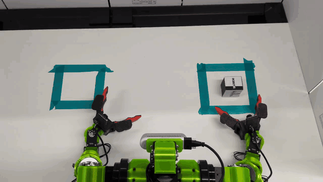
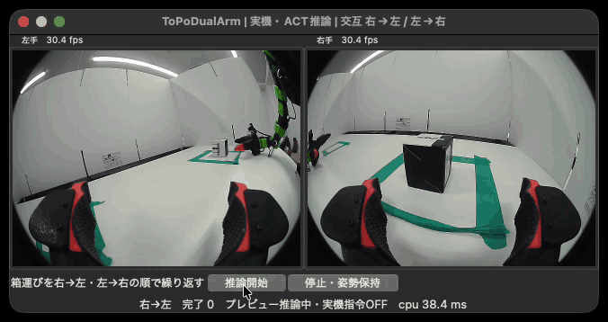

# ToPoDualArm ACTデモ



左右手首の320×240画像と関節の実測角・指令角をLeRobot形式で収録し、ACTを学習します。標準は16軸で、機体YAMLの `modules: [pan_tilt]` を有効にした場合は18軸です。構成を変更するときは新しい収録先と学習先を指定します。

## 環境構築

[uv](https://docs.astral.sh/uv/getting-started/installation/) をインストールしてから、環境を構築します。

### Macの場合

```sh
brew install eigen@3 yaml-cpp tinyxml2
cd demo
uv sync --managed-python --python 3.12
```

### Linuxの場合

```sh
sudo apt update
sudo apt install build-essential cmake libeigen3-dev libyaml-cpp-dev libtinyxml2-dev
cd demo
uv sync --managed-python --python 3.12
```

## データ収集


[demo.yaml](demo.yaml) にU2D2のポート、カメラID、タスク、収録先を指定します。実機の可動域と校正を確認してから `robot.hardware_verified: true` を設定します。

`demo/` で使う入力のYAMLを指定して起動します。GUIには起動時に選んだ入力と接続状態が表示されます。

| 入力 | 起動コマンド | 設定と操作 |
|---|---|---|
| Quest | `uv run demo record config/quest.yaml` | YubiQuestAppの接続先を指定します。 |
| V-Sido | `uv run demo record config/vsido.yaml` | UDPの受信ポート・受信元を指定します。 |
| Glove | `uv run demo record config/glove.yaml` | 左右のポート・ID・開閉端を校正します。腕と首を保持し、グリッパーを操作します。 |
| U2D2リーダー | `uv run demo record config/u2d2.yaml` | 物理リーダーのポートと校正確認を指定します。 |

保存先は `demo.yaml` の `record.root` で指定します。入力YAMLに `root` を指定すると、そのYAMLの場所を基準に上書きできます。各収録で未使用の保存先を使います。どの入力でもGUIの「A 開始／採用」「B 棄却」で操作できます。

共通のサーボ設定は [follower.yaml](../config/hardware/follower.yaml)、Questの座標校正は [quest.yaml](../config/teleop/quest.yaml) にあります。カメラは `left` と `right` を指定し、3視点では `front` を追加します。MacはカメラID、LinuxはV4L2デバイスパスを使います。

### Questのボタン

| ボタン | 操作 |
|---|---|
| **Grip** | 握っている間、対応する腕が追従します。放すと姿勢を保持します。 |
| **人差し指トリガー** | 押すと対応するグリッパーが閉じ、放すと設定した開度に戻ります。 |
| **A** | 待機中は収録開始、収録中は採用して保存します。 |
| **B** | 収録中の試行を棄却します。 |

## 学習

既定では `record.root` のデータから左右手首の2視点で学習し、デモの `outputs/` 以下に学習結果を保存します。保存先は `train.output` で指定します。入力YAMLで収録先を上書きした場合は、学習時にそのパスを指定します。V-Sidoのデータセットは収録先の `vsido/` 以下に保存されます。CUDAが使える場合はGPU、それ以外はCPUを使います。

```sh
uv run demo train
# 収録先を上書きした場合
uv run demo train data/収録先
```

## 推論



`infer.models` に登録したACTモデルをGUIで選び、「推論開始」を押します。「停止」で姿勢を保持します。`infer.models` を省略すると `train.output` の学習済み重みを読み込みます。任意の単一モデルを使う場合は `infer.checkpoint` を指定します。

```sh
uv run demo infer
```

既存の18軸ACTモデルを使う場合は、機体YAMLでパンチルトを有効にし、`uv run demo infer --config config/infer-pan-tilt.yaml` で起動します。モデルと機体で関節一覧が一致する必要があります。
