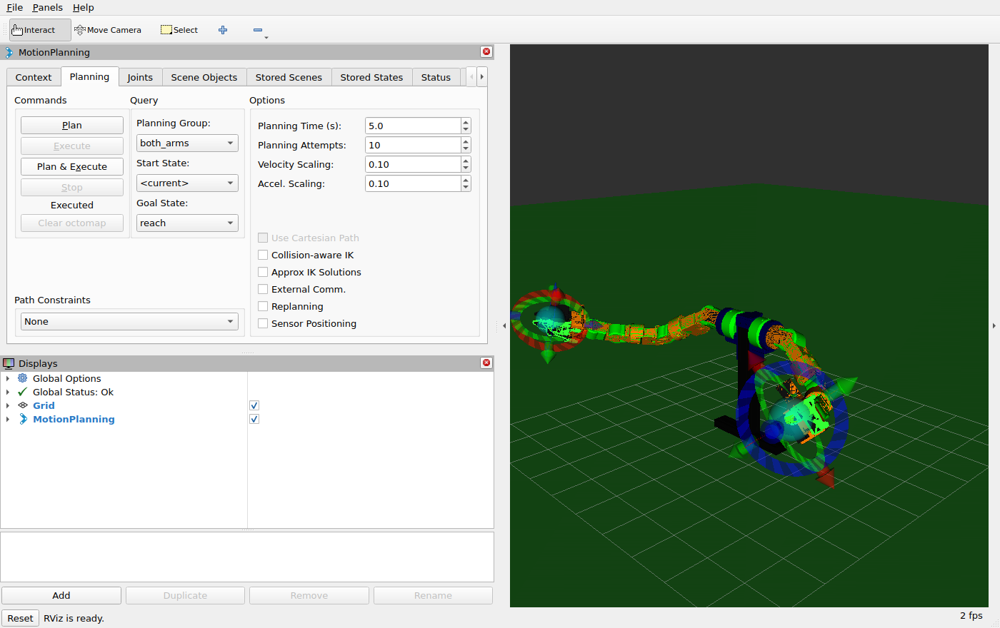
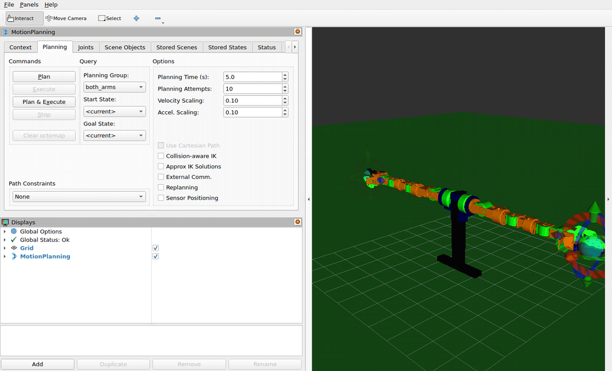

# ToPoDualArm ROS 2



## 環境構築

接続方式に合わせて設定してから起動します。

- **V-Sido**。PCの有線LANにIPアドレスを設定します。 [V-Sido接続方法](../v-sido.md)
- **U2D2**。機体YAMLの `connection.port` にU2D2のポートを設定します。Dockerでは `/dev/ttyUSB0` を指定します。 [フォロワーYAML](../config/hardware/follower.yaml)

### Dockerで起動する場合

Ubuntu上のDockerでV-Sidoの関節I/Oを起動します。

```sh
git clone https://github.com/fuzzrobo/ToPoDualArm.git
cd ToPoDualArm
docker compose -f ros2/docker-compose.yaml up --build
```

既定はJazzyです。Humbleを使う場合はコマンドの先頭に `ROS_DISTRO=humble` を付けます。位置指令を送る場合は、機体YAMLを実機に合わせて `TORQUE=true` を付けて起動します。個別の機体YAMLは `TOPOARM_CONFIG` で指定できます（コンテナ内では `/workspace/config/` 配下）。

U2D2で起動する場合は、コマンドの末尾に `u2d2` を付けます。ホスト側のポートが `/dev/ttyUSB0` と異なる場合は `U2D2_DEVICE` を指定します。

### `ros2_ws/src` にクローンして起動する場合

UbuntuにROS 2 HumbleまたはJazzyをインストールしてから実行します。

```sh
source /opt/ros/jazzy/setup.bash  # Humbleでは jazzy を humble に変更
mkdir -p ~/ros2_ws/src
cd ~/ros2_ws
git clone https://github.com/fuzzrobo/ToPoDualArm.git src/ToPoDualArm
sudo apt update
sudo apt install build-essential cmake python3-rosdep python3-colcon-common-extensions
sudo rosdep init  # 初回のみ
rosdep update --rosdistro "$ROS_DISTRO"
rosdep install --from-paths src/ToPoDualArm/ros2 --ignore-src --rosdistro "$ROS_DISTRO" -y
colcon build --base-paths src/ToPoDualArm/ros2
source install/setup.bash
```

## 実機起動

### Bringup

`/joint_states` で状態を受信し、`/joint_trajectory_controller/follow_joint_trajectory` で軌道を指定できます。

```sh
ros2 launch topoarm_bringup hardware.launch.py backend:=vsido \
  config_file:=/path/to/follower.yaml torque:=true
```

BringupとMoveItの接続方式は `backend:=vsido` または `backend:=u2d2` で切り替えます。

### MoveIt

MoveItはBringupも起動します。MoveItを使う場合は、以下のコマンドだけを実行します。

```sh
ros2 launch topoarm_moveit moveit.launch.py use_fake_hardware:=false backend:=vsido \
  config_file:=/path/to/follower.yaml torque:=true
```

RVizの **MotionPlanning** で関節グループと目標を選び、**Plan & Execute** を押します。


