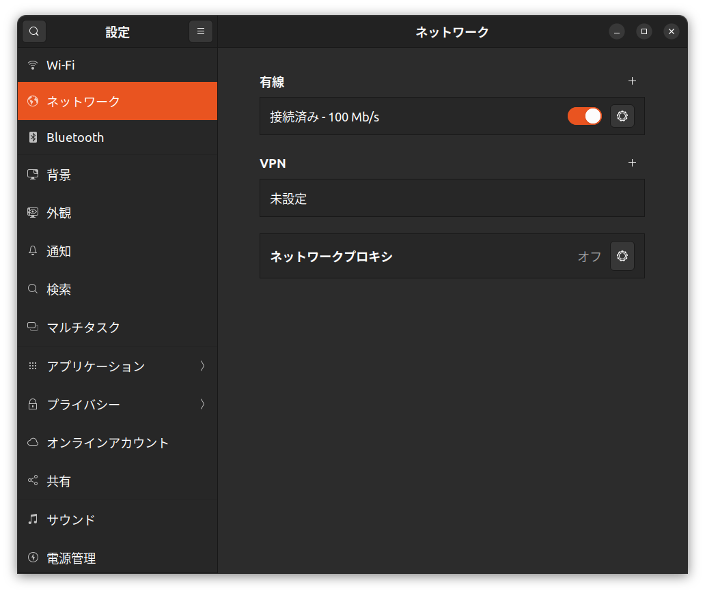
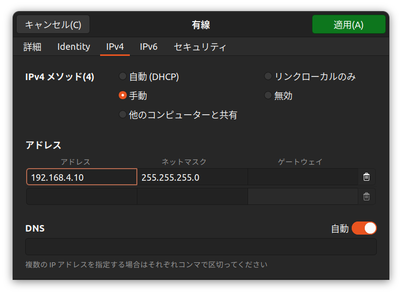

# V-Sido接続方法・通信仕様

ToPoDualArmはV-SidoとEthernet経由のUDPで通信します。バイラテラルモードでは操作中の関節状態を収録でき、通常モードではPCから位置指令を送れます。

## 接続

### 1. PCの有線IPv4を設定する

V-Sidoに接続した有線インターフェースのIPv4を手動にし、IPアドレスを `192.168.4.10`、サブネットマスクを `255.255.255.0` にします。直結の場合、ゲートウェイは空欄にします。

**Ubuntu** は「設定 → ネットワーク」で有線接続をオンにし、歯車から「IPv4 → 手動」を選びます。適用後、有線接続をつなぎ直します。





**Mac** は「システム設定 → ネットワーク → Ethernet（またはUSB LAN）→ 詳細 → TCP/IP」で「IPv4の設定」を「手入力」にします。 [AppleのTCP/IP設定](https://support.apple.com/ja-jp/guide/mac-help/mh14129/mac)

### 2. 疎通を確認する

```sh
ping -c 3 192.168.4.40
```

UDPはユニキャストで送受信します。

| 方向 | 宛先 | 内容 |
|---|---|---|
| V-Sido → PC | `192.168.4.10:8886` | 関節状態 |
| PC → V-Sido | `192.168.4.40:8888` | 位置指令 |

## UDPパケット

### 状態受信

1データグラムに改行区切りのCSV行が入ります。SDKは `id` で各列を機体YAMLの関節に対応付けます。

| 行名 | 内容 |
|---|---|
| `vsd` | ヘッダーと計測周期など |
| `id` | サーボID |
| `agl` | 現在角。単位は0.1° |
| `obj` | 目標角。単位は0.1° |
| `vel` | 現在速度。単位はrpm、省略可 |
| `cur` | 現在電流。単位はmA、省略可 |

2軸分の表記例です。

```text
vsd,interval:10[ms]
id,31,41
agl,100,-200
obj,120,-180
```

### 位置指令

通常モードでは、指令角を0.1°単位の整数にし、1データグラムにカンマ区切りで並べます。指令順は機体YAMLの `vsido.command_order` で指定します。同梱の順序は18軸用です。16軸で使う場合は機器の軸数と順序に合わせます。 [フォロワーYAML](config/hardware/follower.yaml)

SDKは関節可動域と床の制限を適用します。有効な関節状態が `vsido.timeout_s`（既定は100 ms）を超えて途絶すると、位置指令の送信を停止します。再開には接続し直します。
